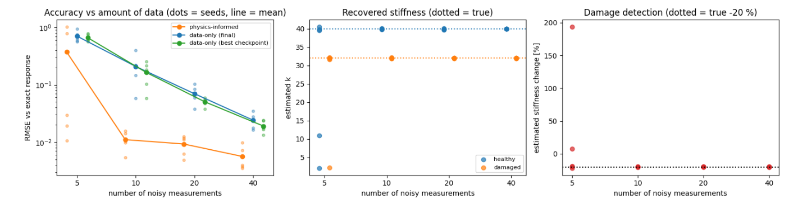

# Physics-informed neural network for stiffness identification and damage detection

A small, self-contained study of whether a neural network that also "knows" the equation of motion can identify a structure's stiffness, and detect damage, from very few noisy measurements.

**Motivation.** Structural health monitoring is limited by the scarcity of real damage data. Physics-informed learning is one way to reduce the amount of data needed. This project is a minimal, controlled test of that idea on the simplest structural system: a damped single-degree-of-freedom oscillator.

> This is a learning project and a controlled numerical experiment, not a research result. All measurements are simulated, and the model is assumed to be exactly right (see Limitations).

## Problem

Free vibration of a damped oscillator:

```
m x'' + c x' + k x = 0,   x(0) = 1,  x'(0) = 0
```

with m = 1, c = 0.4, time window T = 2 s (about two cycles).

| Case | Stiffness k |
|---|---|
| Healthy | 40 |
| Damaged (simulated 20 % stiffness loss) | 32 |

Noisy displacement measurements (Gaussian noise, standard deviation 0.02, response amplitude 1) are generated from the exact solution at random times, so every result can be checked against the truth.

## Method

**Physics-informed neural network (PINN).** A fully connected network (4 hidden layers x 64 units, tanh) maps time `t` to displacement `x(t)`. Velocity and acceleration come from automatic differentiation (TensorFlow `GradientTape`).

1. **Forward problem.** No measurements. The network is trained only on the equation-of-motion residual at 200 collocation points. The initial conditions are built into the network output (`x(t) = X0 + V0 t + (t/T)^2 N(t)`), because a soft penalty on the initial conditions trained poorly on this oscillatory problem.
2. **Inverse problem.** The stiffness `k` is unknown and trainable (stored as `log k`), starting from a wrong guess of 20. The loss is the sum of three terms: data misfit at the measurements, the equation-of-motion residual using the current `k`, and the initial conditions.
3. **Damage detection.** The inverse problem is solved separately for healthy and damaged data, and the estimated change in stiffness is compared with the true -20 %.
4. **Baseline.** An ordinary network (3 x 32, no physics) trained only on the same measurements. It is scored in two ways: after the last training step, and at its best checkpoint. The best-checkpoint score is chosen using the exact solution, which favours the baseline.

**Experiment.** 4 data sizes (5, 10, 20, 40 measurements) x 5 random seeds, for healthy and damaged data. Healthy and damaged runs with the same seed share measurement times and noise (a paired design).

## Results



*Left: error against the exact response (dots = seeds, line = mean). Middle: recovered stiffness. Right: estimated stiffness change (true = -20 %).*

**Forward problem:** RMSE against the exact solution about 0.01 (response amplitude 1), with no measurements.

**Accuracy of the predicted response** (RMSE against the exact solution, mean over 5 seeds):

| Measurements | PINN | Data-only (final) | Data-only (best checkpoint) |
|---|---|---|---|
| 5 | 0.373 (3 of 10 runs failed, see below) | 0.702 | 0.662 |
| 10 | 0.011 | 0.208 | 0.164 |
| 20 | 0.009 | 0.070 | 0.050 |
| 40 | 0.006 | 0.024 | 0.019 |

**Stiffness identification** (true healthy k = 40, damaged k = 32, change -20 %):

| Measurements | k healthy | k damaged | Estimated change |
|---|---|---|---|
| 5 | 26.6 +/- 16.6 | 26.0 +/- 11.9 | not reliable |
| 10 | 39.90 +/- 0.09 | 31.95 +/- 0.11 | -19.9 % |
| 20 | 39.85 +/- 0.14 | 31.94 +/- 0.08 | -19.9 % |
| 40 | 39.96 +/- 0.04 | 31.96 +/- 0.03 | -20.0 % |

(Mean +/- standard deviation over 5 seeds.)

**Findings**

- With 10 or more measurements, the PINN recovered stiffness to within about 0.5 % and detected the simulated 20 % stiffness loss in every run.
- With 10 measurements, the PINN predicted the response more accurately than the data-only network with 40 measurements. The advantage shrinks as data grows (about 19x at 10 points, about 4x at 40).
- **With 5 measurements, training failed in 3 of 10 runs** (healthy seeds 1 and 4, damaged seed 4): the stiffness estimate collapsed to a wrong value (about 2 or 11). Averages at N = 5 mix successful and failed runs and should not be read as typical.
- The spread across seeds is small partly because healthy and damaged runs share the same noise (paired design). Independent measurements would give a larger uncertainty on the estimated change.

## Limitations

- **The model form is assumed exactly right.** Mass and damping are known, the initial conditions are known, and the structure is a single-degree-of-freedom linear oscillator. Real structures violate all of this, and model-form error is the central difficulty when moving from simulation to real data.
- **Free vibration only.** Real monitoring data comes from ambient or unknown excitation.
- **Only stiffness is unknown.** If damping were also unknown, `k` and `c` could trade off against each other (identifiability).
- **The "best checkpoint" baseline uses the exact solution** to pick its best result, which favours the baseline. The baseline was not otherwise tuned.
- **Five seeds** are enough to show the trend, not to quantify it statistically.
- The failures at 5 measurements are not diagnosed. My hypothesis is that 5 points over about two cycles do not constrain the frequency and training settles in a wrong solution; this has not been tested.

## Possible extensions

- Diagnose and fix the failures at low data (random restarts keeping the lowest loss, a data-only warm-up, better initialisation of `k`).
- Unknown damping (identifiability of `k` and `c`).
- A 2-degree-of-freedom shear building, where damage in one storey changes one stiffness.
- Model mismatch: generate data from a slightly different system (e.g. different boundary stiffness or added nonlinearity) than the one the PINN assumes.
- Real benchmark data (e.g. the Z24 bridge benchmark).

## How to run

```bash
python -m venv venv
# Windows: venv\Scripts\activate      macOS/Linux: source venv/bin/activate
pip install -r requirements.txt
jupyter lab
```

Open `notebooks/pinn_oscillator.ipynb` and run all cells from top to bottom (about 5-10 minutes for the main part plus 10-20 minutes for the seed sweep on a laptop CPU). To test quickly, set `SEEDS = [0, 1]` and `N_LIST = [5, 20]` in the sweep cell.

## Repository structure

```
notebooks/pinn_oscillator.ipynb   full experiment (setup, forward, inverse, damage detection, seed sweep)
results/sweep_figure.png          results over seeds and data sizes
results/summary_tables.png        printed summary tables from the sweep
requirements.txt
```

## Author

[Your name], M.Sc. Structural Engineering, Istanbul Technical University
